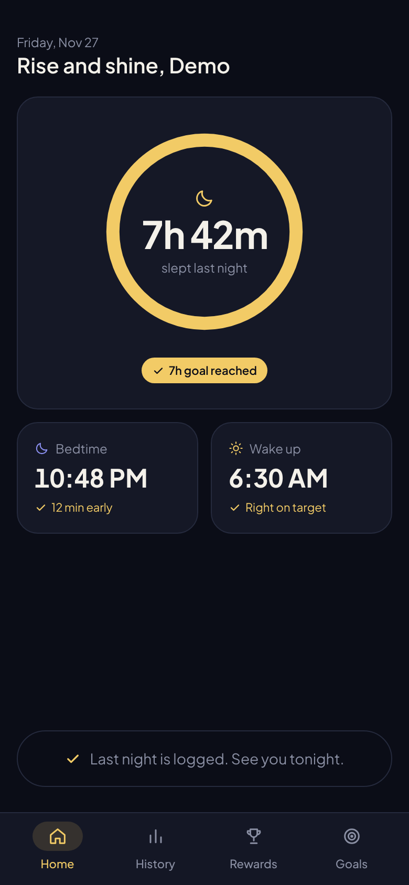
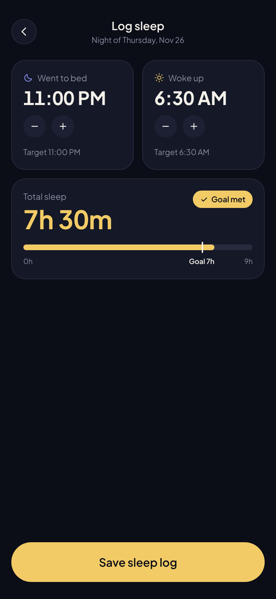

# Drift

A sleep tracker that turns good sleep habits into a game. Log when you went to bed and woke up, and Drift shows how the night compared with your goals. Coming next: XP for sleeping 7+ hours and hitting your target bedtime, streaks, levels and badges.

<p>
  
  
</p>

## Stack

| Layer | Tech | Why |
| --- | --- | --- |
| Web | Next.js 16 (App Router), React 19, TypeScript, Tailwind CSS 4 | Server Components fetch data on the server; Server Actions handle forms without client-side fetch code. |
| API | ASP.NET Core 10 Web API, C# | Strongly typed service with all the rules (validation, scoring) in one tested place. |
| Database | PostgreSQL 17 via Entity Framework Core 10 | Standard SQL, free to run and host; schema changes live in versioned migrations. |
| Contract | OpenAPI → `openapi-typescript` | The web app's request and response types are generated from the API, so a renamed field fails the build. |

```
Browser ──► Next.js server ──REST/JSON──► ASP.NET Core API ──EF Core──► PostgreSQL
            (pages + Server Actions)       (rules, validation)
```

The browser never talks to the API directly: pages fetch on the Next.js server and the form posts through a Server Action. That keeps the API's address private and means there's no CORS setup to get wrong.

## Run it locally

You need [Node 20.9+](https://nodejs.org), the [.NET 10 SDK](https://dotnet.microsoft.com/download) and [Docker](https://www.docker.com/).

```bash
# 1. Database
docker compose up -d

# 2. API on http://localhost:5080 (applies migrations and seeds a demo user on start)
cd api
dotnet run --project Drift.Api

# 3. Web app on http://localhost:3000 (in a second terminal)
cd web
cp .env.example .env.local
npm install
npm run dev
```

Interactive API docs are at http://localhost:5080/scalar while the API runs in Development.

## Project layout

```
api/
  Drift.Core/            Entities and pure sleep logic (time zones, goal checks, validation). No framework code.
  Drift.Infrastructure/  EF Core DbContext, seed data and migrations.
  Drift.Api/             Controllers, request/response contracts, startup.
  Drift.Tests/           xUnit: unit tests for the sleep rules and in-memory API tests.
web/
  src/app/(tabs)/        Screens with the bottom tab bar (Home, History, Rewards, Goals).
  src/app/log/           Log sleep screen and its Server Action.
  src/lib/api/           Typed API client and generated OpenAPI types.
```

## Design decisions

- **Times are stored as UTC instants plus the "night of" date.** The form sends local clock times; the API converts them with the user's time zone, so a 1 AM bedtime still counts for the evening before and nights across a daylight-saving change have their real length.
- **Goals are versioned, not edited.** Changing a goal adds a row, so old nights are always judged against the goal you had then.
- **One log per night is enforced twice:** by the API (a friendly 409) and by a unique index (in case of a race).
- **The sleep rules live in `Drift.Core`** with no database or web dependencies, which makes them fast to unit test.

## Tests

```bash
cd api && dotnet test          # unit + API tests
cd web && npm run lint && npm run typecheck && npm run build
```

CI runs both on every pull request (`.github/workflows/ci.yml`).

After changing the API, regenerate the web types with the API running: `cd web && npm run gen:api`.

## Roadmap

- [x] **Milestone 1:** log a night end to end; Home and Log sleep screens
- [ ] **Milestone 2:** accounts and the Goals screen
- [ ] **Milestone 3:** XP, streaks, levels, badges, weekly challenge and the Rewards screen
- [ ] **Milestone 4:** History charts (week, month, year)
- [ ] **Milestone 5:** deploy, bedtime reminders, demo account
